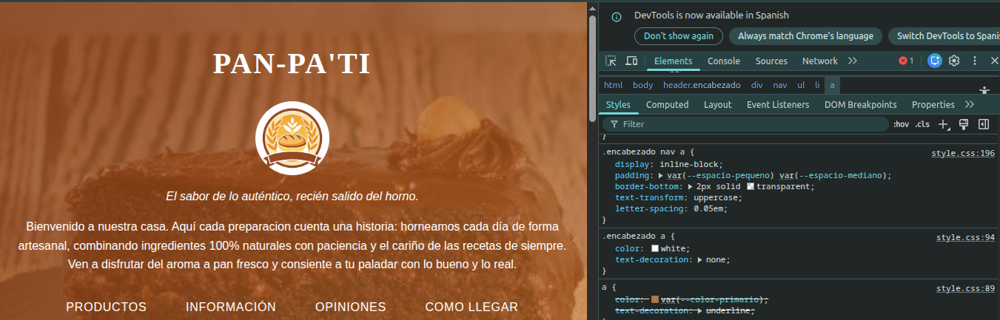
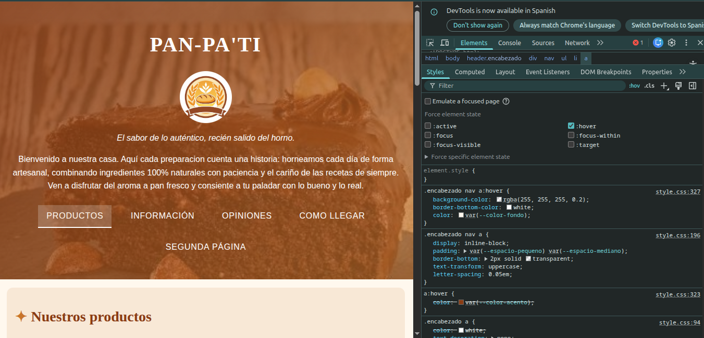
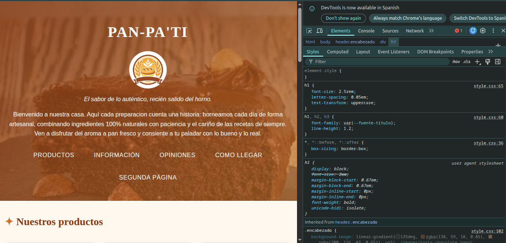

# Pan Pa' Ti · Sitio web de una panadería de barrio

Proyecto entregable de HTML y CSS. Sitio de dos páginas para una panadería artesanal de El Carmen, Bucaramanga. Los datos de contacto (teléfono, opiniones) son inventados.

---

## 1. El proyecto

**Negocio:** Pan Pa' Ti, panadería artesanal ubicada en Calle 45 #10-12, El Carmen, Bucaramanga.

**Para quién es el sitio:** para los vecinos del barrio que quieren saber qué se vende, cuánto cuesta, en qué horario atiende y cómo llegar, sin tener que escribir un mensaje por cada pregunta.

**Qué necesita el cliente:**
- Mostrar sus productos con foto (torta de chocolate, bomba de crema y brazo de reina).
- Publicar precios y horarios en un solo lugar.
- Recibir reservas con un formulario.
- Que el sitio se vea bien en el celular, desde donde entra la mayoría de la gente.
- Transmitir confianza con opiniones de clientes y un mapa de la ubicación.

---

## 2. Estructura

```
Panaderia_Pan -Pa-Ti/
├── index.html
├── segunda_pagina.html
├── README.md
├── css/
│   └── style.css
├── images/
├── video/
└── capturas/
```

- **`index.html`**: presentación, productos, información útil, recomendaciones, opiniones y cómo llegar.
- **`segunda_pagina.html`**: tabla de precios y formulario de reservas.
- **`css/style.css`**: hoja de estilos externa, compartida por las dos páginas.
- **`images/`**: logo y fotos de los productos.
- **`capturas/`**: imágenes que usa este README.

### Etiquetas semánticas y por qué las elegí

| Etiqueta | Dónde la uso | Por qué |
|---|---|---|
| `header` | Encabezado con título, logo y menú | Es la cabecera y se repite en las dos páginas |
| `nav` | Lista de enlaces del encabezado | Agrupa la navegación principal |
| `main` | Contenido de cada página | Hay uno solo por página y contiene lo que cambia |
| `section` | Productos, información, opiniones, cómo llegar, precios, reservas | Cada una es un tema con su propio `h2` |
| `article` | Cada tarjeta de producto | Cada producto tiene sentido por sí solo (foto, título y descripción) |
| `aside` | Recomendaciones | Es contenido complementario, no el principal |
| `blockquote` y `cite` | Opiniones | Son citas de clientes con su autor |
| `table`, `thead`, `tbody` | Precios | Separan el encabezado de los datos |
| `form` y `label` | Reservas | Cada campo tiene su etiqueta asociada con `for` |
| `footer` | Pie de página | Datos de contacto, igual en las dos páginas |

Cada página tiene **un solo `h1`**.

---

## 3. Sistema visual

Todo el color, la tipografía y los espacios están en variables dentro de `:root` y se usan con `var(--nombre)` en toda la hoja.

```css
:root {
  --color-fondo: #fff8ee;
  --color-texto: #3b2a20;
  --color-primario: #c8742b;
  --color-acento: #8a3b12;
  --color-sombra: rgba(59, 42, 32, 0.15);

  --fuente-titulo: Georgia, serif;
  --fuente-texto: "Segoe UI", Arial, sans-serif;

  --espacio-pequeno: 0.5rem;
  --espacio-mediano: 1rem;
  --espacio-grande: 2rem;

  --radio: 0.75rem;
}
```

| Variable | Por qué la elegí |
|---|---|
| `--color-fondo` (crema) | Recuerda la masa y el pan, y descansa la vista |
| `--color-texto` (café oscuro) | Buen contraste sobre el crema, más cálido que el negro |
| `--color-primario` (naranja horneado) | Color de marca: botones, bordes y títulos de tabla |
| `--color-acento` (café rojizo) | Pie de página, títulos `h2` y estados `:hover` |
| `--color-sombra` | Color con canal alfa (0.15) para sombras suaves |
| `--fuente-titulo` (Georgia) | Aire clásico y artesanal en los títulos |
| `--fuente-texto` (Segoe UI) | Clara y legible en pantallas pequeñas, con Arial y sans-serif de respaldo |
| `--espacio-*` | Tres medidas fijas (0.5, 1 y 2 rem) para que todo el sitio tenga el mismo ritmo |
| `--radio` | Esquinas redondeadas iguales en tarjetas, imágenes y formulario |

**Ventaja de usar variables:** si el cliente quiere cambiar el color de la marca, se cambia en un solo lugar y se actualiza todo el sitio.

---

## 4. Especificidad

La especificidad se calcula como **(IDs, clases, etiquetas)** y se compara de izquierda a derecha. Cada ID suma en la primera posición; cada clase, atributo o pseudoclase (como `:hover`) suma en la segunda; cada etiqueta o pseudoelemento suma en la tercera. Si hay empate, gana la regla que aparece **después** en el archivo.

### Conflicto 1: el color de los enlaces del menú

Reglas que compiten sobre el mismo `<a>` del encabezado:

```css
a                { color: var(--color-primario); text-decoration: underline; }  /* (0,0,1) */
.encabezado a    { color: white; text-decoration: none; }                       /* (0,1,1) */
```

Gana `.encabezado a` porque tiene 1 clase contra 0 clases de `a`. Por eso los enlaces del menú son blancos y sin subrayado sobre el fondo oscuro, y los demás enlaces del sitio son naranjas y subrayados. Aunque `a` estuviera escrita después, perdería igual.



### Conflicto 2: el color del enlace al pasar el mouse

Reglas que compiten sobre el mismo enlace del menú cuando tiene el mouse encima:

```css
.encabezado a             { color: white; }                    /* (0,1,1) */
a:hover                   { color: var(--color-acento); }      /* (0,1,1) */
.encabezado nav a:hover   { color: var(--color-fondo); }       /* (0,2,2) */
```

Gana `.encabezado nav a:hover` porque suma 2 clases (`.encabezado` y `:hover`) y 2 etiquetas (`nav` y `a`), contra 1 clase y 1 etiqueta de las otras dos. Si no existiera esa tercera regla, `a:hover` pondría el texto café oscuro sobre el fondo café del encabezado y casi no se leería.




### Conflicto 3 (resuelto por orden): el tamaño del título en el celular

Reglas que compiten sobre el mismo `<h1>`:

```css
h1 { font-size: 2.5rem; }                       /* (0,0,1) */  ← fuera del @media

@media (max-width: 600px) {
  h1 { font-size: 1.75rem; }                    /* (0,0,1) */  ← dentro del @media, al final del archivo
}
```

Las dos tienen la misma especificidad `(0,0,1)`, y el `@media` no suma puntos. Por eso gana la que está **después** en el archivo, y por eso el bloque `@media` va al final de la hoja. A 360 px el título mide 1.75 rem y la regla de 2.5 rem aparece tachada.




---

## 5. Herencia

**Propiedades que se heredan: `color`, `font-family` y `text-align`.** Las declaro una sola vez y las heredan los elementos de adentro:

```css
body {
  font-family: var(--fuente-texto);
  color: var(--color-texto);
}

.encabezado {
  color: white;
  text-align: center;
}
```

En el encabezado, el `h1`, los párrafos y los elementos del menú quedan blancos y centrados sin que yo se lo escriba a cada uno. En el resto del sitio, los `p`, `li` y `td` usan el café y la fuente de `body`. En el inspector aparecen en "Heredado de body" o "Heredado de .encabezado".

Los enlaces son una excepción que se nota: aunque `.encabezado` pone `color: white`, el navegador le da su propio color a `<a>`, y por eso necesité la regla `.encabezado a { color: white; }`.

**Propiedades que no se heredan: `border`, `padding` y `margin`.** La tarjeta tiene borde y padding:

```css
.tarjeta {
  border: 1px solid var(--color-sombra);
  border-left: 6px solid var(--color-primario);
  padding: var(--espacio-mediano);
}
```

El `h3` y el `p` que están dentro de `.tarjeta` no tienen borde propio ni se agregan otro padding: cada elemento tiene sus propias cajas.

---

## 6. Modelo de cajas

Uso `box-sizing: border-box` en todos los elementos, así el `width` ya incluye el padding y el borde:

```css
*, *::before, *::after { box-sizing: border-box; }
```

### Ancho total de `.tarjeta` en un celular de 360 px

```css
main    { padding: var(--espacio-pequeno); }                /* dentro del @media: 0.5rem = 8 px */
.tarjeta {
  padding: var(--espacio-mediano);                          /* 1rem = 16 px */
  border: 1px solid var(--color-sombra);
  border-left: 6px solid var(--color-primario);
}
```

- Ancho de la pantalla: 360 px.
- Menos el padding de `main` a cada lado: 360 − 8 − 8 = **344 px** de ancho para la tarjeta.
- Padding de la tarjeta: 16 + 16 = 32 px.
- Borde de la tarjeta: 6 (izquierdo) + 1 (derecho) = 7 px.
- Contenido de la tarjeta: 344 − 32 − 7 = **305 px**.

Comprobación: contenido + padding + borde = 305 + 32 + 7 = 344 px. Con `border-box`, el ancho total es 344 px; con `content-box` habría que escribir el `width` de 305 px a mano para llegar al mismo resultado.

### Márgenes que se solapan

En la sección de información, el `h2` va seguido directo por un `h3`:

- `h2` (1.75 rem = 28 px) trae un margen inferior por defecto de 0.83 em = 23.24 px.
- `h3` (1.25 rem = 20 px) trae un margen superior por defecto de 1 em = 20 px.

Los márgenes verticales de hermanos no se suman: se queda el mayor. La separación real es **23.24 px**, no 43.24 px. Lo comprobé en la pestaña "Computed" del inspector.

---

## 7. Selectores

| Tipo | Selector | Para qué |
|---|---|---|
| Clases BEM | `.tarjeta`, `.tarjeta__imagen` | Componente de tarjeta de producto y su imagen |
| Atributo | `a[target="_blank"]::after`, `input[type="email"]` | Marca los enlaces externos y destaca el campo de correo |
| Combinador de hijo | `.tarjeta > h3` | Solo el título que es hijo directo de la tarjeta |
| Combinador de hermano | `h2 + p` | El párrafo que sigue inmediatamente a cada `h2` |
| Pseudoclase estructural | `.tabla tbody tr:nth-child(even)` | Filas alternas de la tabla de precios |
| Pseudoelementos | `h2::before`, `a[target="_blank"]::after`, `li::marker` | Adornos antes del título, flecha en enlaces externos y viñetas de color |

### Cómo funciona mi pseudoclase estructural

```css
.tabla tbody tr:nth-child(even) { background-color: rgba(200, 116, 43, 0.12); }
```

Especificidad: `(0,2,2)`. `:nth-child(even)` cuenta **todos los hermanos** dentro del mismo `tbody` y aplica el estilo a los de posición par (2, 4, 6...). Mi `tbody` tiene 4 filas: torta de chocolate (1), bomba de crema (2), brazo de reina (3) y la nota de pedidos por encargo (4). Termina aplicándose a la **bomba de crema** y a la **fila de la nota**. Cuenta por posición entre los hermanos, no por contenido, y la fila con `colspan` cuenta como una fila más. La fila de títulos (`th`) no cuenta porque está en el `thead`, otro contenedor.

---

## 8. Responsive

El sitio es de una columna en celular y tiene dos ajustes con `@media`:

```css
/* Pantallas grandes: las tarjetas pasan a 3 columnas */
@media (min-width: 48rem) {
  .producto { display: grid; grid-template-columns: repeat(3, 1fr); gap: var(--espacio-mediano); }
  .producto > h2 { grid-column: 1 / -1; }
  .producto .tarjeta { margin-bottom: 0; }
}

/* Celular (360 px entra aquí) */
@media (max-width: 600px) {
  main { padding: var(--espacio-pequeno); }
  h1 { font-size: 1.75rem; }
  h2 { font-size: 1.4rem; }
  .encabezado nav li { display: block; margin: 0; }
  .encabezado nav a { display: block; }
  .tabla th, .tabla td { padding: var(--espacio-pequeno); }
  .tarjeta__imagen { height: 10rem; }
  iframe { height: 18rem; }
}
```

**Qué cambia y por qué en el celular:**
- Menos `padding` en `main` para ganar espacio útil.
- Títulos más pequeños para que no se corten ni se salgan de la pantalla.
- El menú se apila (un enlace por línea) para que cada enlace sea fácil de tocar con el dedo.
- La imagen y el mapa bajan de alto para que no ocupen toda la pantalla.

**Qué hace que no se desborde:** `img`, `iframe` y `video` tienen `max-width: 100%`, el texto largo usa `overflow-wrap: anywhere`, y las secciones de tabla y mapa tienen `overflow-x: auto`, así si algo no cabe, el scroll queda dentro de esa sección y no en toda la página.

El `@media` va **al final** del archivo porque no suma especificidad: gana por orden (ver Conflicto 3).

---

## 9. Problemas y soluciones

### Problema 1: la página se veía sin ningún estilo

- **Qué pasaba:** el navegador mostraba el HTML crudo (fondo blanco y letras negras).
- **Por qué:** el `<link>` decía `href="styles.css"`, pero mi archivo está en `css/style.css`. Con una ruta que no existe, el navegador no carga nada. Además, la segunda página no tenía el `<link>`.
- **Cómo lo arreglé:** corregí la ruta en las dos páginas.

```html
<link rel="stylesheet" href="css/style.css">
```

### Problema 2: las variables no funcionaban

- **Qué pasaba:** los colores y espacios no se aplicaban aunque usaba `var(...)`.
- **Por qué:** `:root` tenía varios errores: variables sin valor, líneas que terminaban en `:` en vez de `;`, la letra `o` en vez del cero en `0.75rem`, y nombres escritos con mayúscula (`--Color-fondo`) que luego llamaba en minúscula (`--color-fondo`). CSS distingue mayúsculas, así que eran variables distintas.
- **Cómo lo arreglé:** completé los valores, corregí los `;` y escribí todos los nombres en minúscula y sin ñ.

### Problema 3: las clases del HTML no coincidían con el CSS

- **Qué pasaba:** algunas reglas no se aplicaban a las tarjetas ni a las secciones.
- **Por qué:** `class="Tarjeta imagen"` son en realidad dos clases separadas, había clases con mayúscula (`Tarjeta`, `Precios`) y otras en minúscula (`tarjeta`), y CSS las trata como distintas.
- **Cómo lo arreglé:** pasé todas las clases a minúscula, sin espacios y con nombres BEM (`tarjeta`, `tarjeta__imagen`).

### Problema 4: el enlace del pie desaparecía al pasar el mouse

- **Qué pasaba:** al poner el mouse sobre el enlace de Instagram del pie, el texto se confundía con el fondo.
- **Por qué:** `.pie a` (0,1,1) pone el texto blanco y `a:hover` (0,1,1) lo pone café oscuro. Hay empate, gana la que va después (`a:hover`), y el texto queda del mismo color que el fondo del pie.
- **Cómo lo arreglé:** agregué una regla más específica para el pie:

```css
.pie a:hover { color: var(--color-fondo); }   /* (0,2,1) gana a a:hover (0,1,1) */
```

---

## 10. Capturas

### Página principal

| Escritorio | Celular (360 px) |
|---|---|
|  |  |

### Segunda página (precios y reservas)

| Escritorio | Celular (360 px) |
|---|---|
|  |  |

